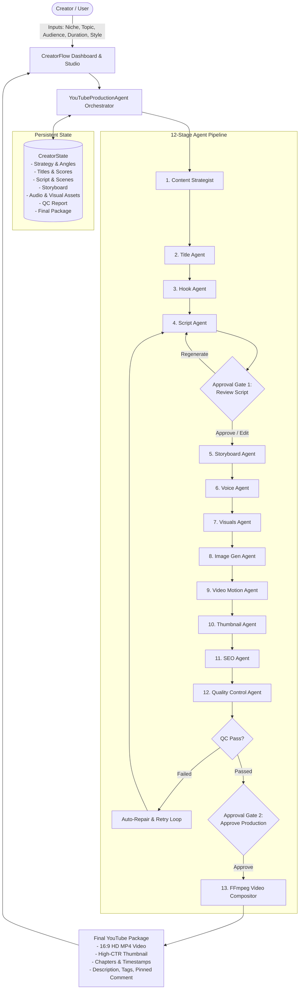
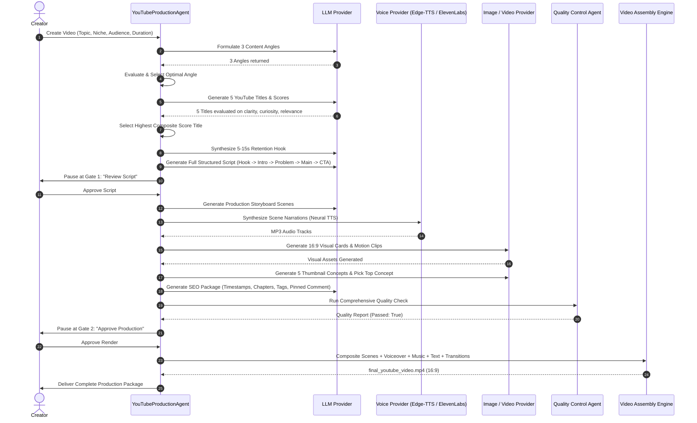

# CreatorFlow AI

> **“From Idea to YouTube Video — Autonomously.”**  
> An AI-powered Autonomous YouTube Production Agent that takes a creator's niche, topic, target audience, preferred language, and video style, then autonomously plans, writes, voices, designs, validates, and renders a complete, production-ready YouTube video package.

---

## 1. Project Overview

**CreatorFlow AI** is not a chatbot. It is a full-lifecycle **autonomous AI agentic production studio**. 

Traditional generative AI workflows require creators to manually prompt an LLM for ideas, copy the output into another tool for titles, re-prompt for scripts, switch to a third-party TTS dashboard, paste prompts into image generators, manually assemble clips in video editing software, and copy-paste SEO tags. 

CreatorFlow AI replaces this fragmented ordeal with a single unified, intelligent agent pipeline. The agent maintains a structured state machine (`CreatorState`), evaluates decisions at each juncture, invokes specialized tool providers, executes quality control checks with an autonomous retry loop, accommodates human approval gates for high-leverage steps, and composites actual 16:9 MP4 video packages via FFmpeg.

---

## 2. The Problem

Creating high-retention YouTube content is complex and multidisciplinary:
* **Fragmented Tooling**: Creators juggle 5+ disjointed subscriptions (ChatGPT, Claude, Midjourney, ElevenLabs, Premiere Pro/DaVinci, vidIQ/TubeBuddy).
* **Superficial LLM Outputs**: Simple chatbot prompts lack strategic pacing, retention hooks, visual direction, and sound design cues.
* **Absence of Validation**: Single-shot AI outputs frequently drift from the target duration, miss visual prompts, or fail to connect the opening hook with the call to action.
* **No Autonomous Assembly**: Creators still spend hours manually timing images to speech, placing on-screen captions, and rendering video files.

---

## 3. The Solution

CreatorFlow AI treats video creation as an **autonomous multi-stage engineering pipeline**:
1. **Goal-Oriented Execution**: Takes high-level creator intent (niche, topic, audience, duration, language, style, voice) and manages all 12 production stages.
2. **Deterministic State Machine**: Employs a strongly typed `CreatorState` tracking every stage from content strategy to final MP4 rendering.
3. **Swappable Provider Layer**: Decoupled abstractions for LLMs (OpenAI, Gemini, Local Engine), Voice (ElevenLabs, Edge-TTS, OpenAI TTS, Google TTS), Images (DALL-E 3, Gemini, Local Creative Engine), and Video (Veo, Runway, Local Ken-Burns Motion).
4. **Quality Control & Autonomous Recovery**: Inspects content relevance, narration coverage, visual completeness, and package readiness, autonomously repairing flaws before final rendering.
5. **Human-in-the-Loop Governance**: Strategic approval gates allow creators to review and edit scripts or adjust production assets before expensive rendering actions.
6. **Real MP4 Video Assembly**: Bundles a standalone FFmpeg engine to composite visuals, synthesized narration, background audio, and on-screen text into 16:9 YouTube videos.

---

## 4. Why This Is an AI Agent (Not a Chatbot)

| Feature | Chatbot / Prompt Wrapper | CreatorFlow AI Agent |
| :--- | :--- | :--- |
| **Interaction Paradigm** | Passive turn-based question/answer | Autonomous multi-stage execution |
| **State Management** | Ephemeral chat message history | Persistent, typed `CreatorState` data model |
| **Decision Making** | Blindly spits out whatever LLM generates | Evaluates 3 angles & 5 titles with scoring algorithms to pick the winner |
| **Error Recovery** | Fails silently or halts on error | Autonomous retry & repair loop upon QC failure |
| **Tool Orchestration** | Limited function calling | Integrates LLMs, TTS providers, image engines, and FFmpeg video compositing |
| **Human-in-the-loop** | User must manually manage flow | Configurable approval gates pause for sign-off before irreversible actions |
| **Final Output** | Plain text markdown | Complete YouTube package: 1080p MP4, thumbnail, chapters, description, tags, pinned comment |

---

## 5. Agent Architecture



---

## 6. Detailed Production Pipeline



---

## 7. Tool & Service Architecture

CreatorFlow AI utilizes specialized micro-services organized cleanly within `backend/services/`:
* **`YouTubeProductionAgent` (`backend/services/orchestrator.py`)**: Master state machine driving stages 1 through 13. Manages state persistence, transition checks, retry policies, and safe action logging.
* **`QualityControlAgent` (`backend/services/quality_agent.py`)**: Rule-based and generative validator evaluating topic keywords, script duration bounds, scene-by-scene narration and visual presence, and YouTube package completeness.
* **`VideoAssembler` (`backend/services/video_assembler.py`)**: High-performance video engine leveraging FFmpeg to standardize aspect ratios (16:9), generate smooth Ken-Burns camera zoom effects, overlay on-screen subtitles, duck ambient background audio, and stitch final MP4 videos.
* **`ProjectStorage` (`backend/services/storage.py`)**: Persistent JSON store and in-memory cache supporting instant dashboard metrics, multi-project workflows, and pre-seeded demo models.

---

## 8. Provider Architecture

All external dependencies are abstracted behind polymorphic base classes in `backend/providers/base.py`:

```
backend/providers/
├── base.py                 # Abstract Base Classes
├── llm_provider.py         # Gemini, OpenAI, & Domain Intelligence Engine
├── voice_provider.py       # EdgeTTSProvider, ElevenLabs, OpenAITTS, GoogleTTS, MockTTS
├── image_provider.py       # OpenAI DALL-E 3, Gemini, & Creative Local Visual Engine
└── video_provider.py       # Runway Gen-3, Veo, & Local Ken-Burns Motion Engine
```

### No Fake API Calls
The system strictly enforces transparency:
* **`GENERATED`**: Real asset generated via provider.
* **`PLACEHOLDER`**: High-fidelity local asset generated with typography and gradients when external keys are absent.
* **`WAITING FOR API`**: Flagged when external GPU render endpoints are queued.

---

## 9. Human-in-the-Loop (HITL) Governance

CreatorFlow AI recognizes that autonomous production requires creator discretion at critical milestones:
1. **Script Review Gate**:
   * *Trigger*: After Title Selection, Hook Synthesis, and Script Writing.
   * *Actions*: `[Approve & Continue]`, `[Regenerate]`, or `[Edit Script]` (modify narration, on-screen text, or titles in real-time).
2. **Production Render Gate**:
   * *Trigger*: After Storyboard, Voiceover, Visual Assets, Thumbnail, and SEO have passed Quality Control.
   * *Actions*: `[Approve & Render Video]` or `[Edit Scenes]`.

---

## 10. Quality Control & Autonomous Recovery

If the Quality Control Agent detects an inconsistency (e.g., narration missing from a scene, duration drifting by more than 45% from target, or missing core topic keywords):
1. The agent identifies the exact defective stage (`affected_stage`).
2. Logs a diagnostic event in the Activity Log.
3. Automatically re-executes the affected stage with refined parameters.
4. Re-evaluates quality criteria up to 2 retry attempts.
5. If passed, resumes to the next human review gate.

---

## 11. Tech Stack

* **Backend**: Python 3.13, FastAPI, Uvicorn, Pydantic v2, Pillow (PIL), NumPy, Httpx, Edge-TTS
* **Video & Audio Processing**: FFmpeg 7.1 (bundled via `imageio-ffmpeg`), Libx264, AAC
* **Frontend**: HTML5, Vanilla CSS3 (Custom Design System with Inter & Plus Jakarta Sans typography), ES6 JavaScript (No heavyweight framework runtime required)
* **Design Philosophy**: Linear / Vercel / Descript inspired, responsive 16:9 video player, glassmorphism, soft gradients, dark/light theme toggle, safe activity log drawer.

---

## 12. Installation & Quickstart

### Prerequisites
* Python 3.10+ (Tested on Python 3.13)
* Node.js v18+ (Optional for development)

### 1. Clone & Setup
```bash
git clone https://github.com/your-org/creatorflow-ai.git
cd creatorflow-ai
```

### 2. Install Python Dependencies
```bash
pip install fastapi uvicorn pydantic pillow imageio-ffmpeg edge-tts httpx
```

### 3. Run Application Server
```bash
python -m uvicorn backend.main:app --host 127.0.0.1 --port 8080 --reload
```

### 4. Access Studio Dashboard
Open your browser and navigate to:
```
http://127.0.0.1:8080/
```

---

## 13. Environment Variables (Optional)

Create a `.env` file in the root directory if you wish to connect external API providers:

```env
# Optional LLM Provider (Falls back to high-fidelity local domain engine)
GEMINI_API_KEY=your_gemini_api_key_here
OPENAI_API_KEY=your_openai_api_key_here

# Optional TTS Provider (Falls back to high-fidelity Neural Edge-TTS)
ELEVENLABS_API_KEY=your_elevenlabs_api_key_here

# Optional Video & Image Providers (Falls back to local creative engine)
RUNWAY_API_KEY=your_runway_api_key_here
REPLICATE_API_TOKEN=your_replicate_token_here

# Server Configuration
HOST=127.0.0.1
PORT=8080
DEBUG=true
```

---

## 14. Demo Workflow ("Try Demo")

CreatorFlow AI includes a one-click autonomous demonstration:
1. Click **“Try Demo”** in the header.
2. The agent initializes a project with:
   * **Niche**: AI & Technology
   * **Topic**: “Why AI Agents Are Different From Chatbots”
   * **Audience**: Beginner developers
   * **Duration**: 3 min
   * **Style**: Cinematic educational
3. The agent autonomously generates Strategy, 5 Title Options, Hook, and 7 Script Scenes, then pauses at **Approval Gate 1: Review Script**.
4. Click **“Approve & Continue”** to trigger Storyboard generation, Neural Voiceover synthesis, and Visual Card generation.
5. The Quality Control agent inspects all assets and unlocks **Approval Gate 2: Approve Production**.
6. Click **“Approve & Render Video”** to watch FFmpeg assemble the real 16:9 MP4 video.
7. Download your MP4 and copy your complete YouTube SEO package with one click!

---

## 15. Future Roadmap

- [ ] Direct YouTube Data API v3 OAuth upload integration (Draft vs. Public schedule).
- [ ] Multilingual automated voice cloning & translation (Spanish, German, Japanese).
- [ ] Automated B-roll keyword matching with Pexels/Shutterstock APIs.
- [ ] Interactive waveform timeline editor for precise audio trimming.
- [ ] Automated YouTube Shorts / TikTok 9:16 vertical re-framing.

---

## License

MIT License © 2026 CreatorFlow AI Team.
